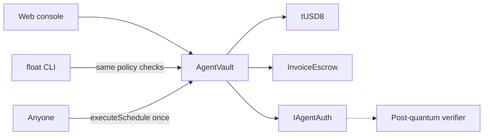

# Float

Give your agents a float, not your keys.


The same cut with sound is [docs/float-demo.mp4](docs/float-demo.mp4). A README image cannot carry audio.

The live app is [float-blush-nu.vercel.app](https://float-blush-nu.vercel.app/).

Float is a tUSD8 vault for the Aevum Builder Challenge. The owner deposits the stablecoin and writes a policy. An agent can pay only inside that policy: a per-transaction cap, a rolling day, an allowlist, an expiry, and pause or revoke. A sentence — from a person or from a parser — is only an intent. The vault is the authority.

Network: **Aevum testnet, chain id 44005**. Not QDay Origin (44003). Native gas is tQDAY, 18 decimals. RPC, explorer, faucet, the tUSD8 address, the token decimals, and the deployed contract addresses live in one file: `packages/sdk/src/config.ts`. tUSD8 `decimals()` on that network is **6**. Do not copy the token address into another file. The deploy script reads the address and the decimals from that file.

Aevum is the Shanghai EVM. Contracts compile with `evm_version = "shanghai"` (no `MCOPY`, `TSTORE`, or blob opcodes). Live transactions are legacy, type 0. There is no WebSocket RPC. `eth_getLogs` is read in slices of at most 1,000 blocks, starting at the vault deploy block. tUSD8 accepts EIP-3009 `receiveWithAuthorization` (domain name `tUSD8`, version `2`). Live mode can fund the vault with that authorization. A payment that settles on any other chain does not count.

The vault, escrow, router, and auth addresses in that file are the [live deployment](#deployed-on-aevum). Live mode refuses to invent a transaction while the vault address is empty.

## Architecture



- **AgentVault** holds the token. Agents call `pay`, or a relayer submits an EIP-712 intent (domain name `Float Vault`). A late schedule pays once and sets `nextRun = now + interval`.
- **InvoiceEscrow** holds a payment until delivery is confirmed, the confirm window elapses, the due date passes, or the arbiter resolves a dispute.
- **IAgentAuth.verify(claimedSigner, digest, signature)** is the only signature check. ECDSA ships today. A post-quantum verifier replaces it with `setAuth`.
- The **console** is the product. Connect an Ethereum wallet that can add a custom network, then send on Aevum. The agent signs an intent. The connected wallet only submits it. Reverts (including `PayeeNotAllowed`) are shown as the contract returned them, with an explorer link when a send succeeds.

## Layout

```
contracts/       Foundry
packages/sdk/    chain config and the typed vault client
cli/             float binary, keystore, MCP
agent/           payables script, x402 demo, AGENTS.md
src/             web console
```

## Contracts

From `contracts/` (OpenZeppelin and forge-std are installed locally, not committed):

```
forge install foundry-rs/forge-std OpenZeppelin/openzeppelin-contracts --no-commit
forge build
forge test
```

`forge test` runs the unit tests, the fuzz tests, and the invariant suite. One case warps a schedule 10 hours: one execution charges once, an immediate second call reverts `NotDue`, and the next interval is the second charge (`runs == 2`).

Local deploy (Anvil's default chain id, not 44005 — that id selects the real tUSD8 and will not deploy a mock). Anvil account #0 is the default key, local only:

```
anvil
cd contracts
forge script script/Deploy.s.sol --rpc-url http://127.0.0.1:8545 --broadcast --legacy
```

Aevum testnet. `aevum` is the RPC alias in `contracts/foundry.toml` (`https://rpc-test.qday.info`). Put `DEPLOYER_PRIVATE_KEY` in your shell, not in a file. The key must hold tQDAY. `OWNER_ADDRESS` is optional and defaults to the deployer.

```
cd contracts
forge script script/Deploy.s.sol --rpc-url aevum --broadcast --legacy --verify --verifier blockscout --verifier-url https://explorer-test.qday.info/api
```

That writes `contracts/deployments/latest.json`. The script reads the token address and decimals from `packages/sdk/src/config.ts`. On chain 44005 it uses that token, checks `decimals()`, and refuses to deploy `MockTUSD8`. On any other chain, if `TUSD8_ADDRESS` is unset, it deploys `MockTUSD8` (6 decimals, so `150e6` in the tests is 150 whole tokens). Record a new deployment by replacing the vault, escrow, router, and auth addresses in `packages/sdk/src/config.ts` only.

## Deployed on Aevum

Live contracts from [`62977c1`](https://github.com/web3wizzz/float/commit/62977c1b19d27acefb7f046cd18142f9342bf8ca) (`62977c1b19d27acefb7f046cd18142f9342bf8ca` on `main`), created in [block 3478293](https://explorer-test.qday.info/block/3478293) (2026-11-18 08:49:16 UTC). Owner and arbiter: [`0xDB48dcb9C896238369b67E33f22c925cB3D41eE2`](https://explorer-test.qday.info/address/0xDB48dcb9C896238369b67E33f22c925cB3D41eE2). The token is tUSD8 [`0x456569838f1d43009A91ebA4263147Afd7233483`](https://explorer-test.qday.info/address/0x456569838f1d43009A91ebA4263147Afd7233483) (`decimals()` is 6). On chain, `AgentVault.token()` is that token and `AgentVault.escrow()` is the escrow below.

| Contract | Address |
| --- | --- |
| AgentVault | [`0xCa1F3bFdFc4004EEf19111b8D4d2E420744198ce`](https://explorer-test.qday.info/address/0xCa1F3bFdFc4004EEf19111b8D4d2E420744198ce) |
| InvoiceEscrow | [`0xE6d8E06991921A56BD62Ae95340f123F53c5Eef7`](https://explorer-test.qday.info/address/0xE6d8E06991921A56BD62Ae95340f123F53c5Eef7) |
| PaymentRouter | [`0xec74B3999870D8f1790B7e5Cbf50Ae98e084F865`](https://explorer-test.qday.info/address/0xec74B3999870D8f1790B7e5Cbf50Ae98e084F865) |
| EcdsaAgentAuth | [`0x33A0Dd609361De16b46a438062E41aC11fF10EF5`](https://explorer-test.qday.info/address/0x33A0Dd609361De16b46a438062E41aC11fF10EF5) |
| DeployPlan (library) | [`0x58f8a88F2049b1984f22f376cd940896432a41a0`](https://explorer-test.qday.info/address/0x58f8a88F2049b1984f22f376cd940896432a41a0) |

The four runtime addresses are the `contracts` export in `packages/sdk/src/config.ts`. The CLI, the web console, and the x402 demo read that file. The DeployPlan library is linked by the deploy script and is not part of that export. Its explorer page is only partially verified and currently labels the bytecode `Vm`; the runtime code is `DeployPlan.choose`.

CLI and console amounts are whole tUSD8. A live transaction scales them with `tusd8Decimals`, so 150 tUSD8 is `150000000` base units.

## CLI

Node 22. The binary is `float`. The keystore is scrypt + AES-256-GCM. The private key is never printed. The password is `FLOAT_PASSWORD` or a TTY prompt, never an argv value.

```
export FLOAT_PASSWORD='choose-one'
float init --json
float link --json
float admin deposit 1000 --json
float admin approve --per-tx 150 --daily 400 --allow "Acme Studio,DataRelay" --json
float invoice pay agent/invoices/INV-0142.json --json
float pay "Acme Studio" 180 --memo over --json
float chat "pay Northwind 10 tUSD8" --yes --json
float x402 --json
float mcp
```

`chat` only parses the sentence into a typed intent (`source: "parser"`). `--yes` submits that intent through the same ledger functions as `pay` and `invoice pay`. There is no model call, and a parsed intent still loses to the policy. Northwind is rejected with `PayeeNotAllowed` because it is not on the allowlist.

`float mcp` speaks MCP over stdio: `float_balance`, `float_policy`, `float_pay`.

## x402-style demo

Not full x402 compliance.

What matches the idea: the resource answers **402** with a price, chain, and `payTo`. The agent pays from the vault, retries with `X-Payment-Proof`, and a second use of that proof is rejected.

What differs: the proof is a raw id, there is no facilitator `/verify` + `/settle`, and the sandbox ledger prices whole tUSD8. The 402 body carries `extra.baseUnits` (`whole * 10^tusd8Decimals`) for the chain. Network is `eip155:44005`. The token field and decimals are read from the SDK config.

```
node --experimental-strip-types agent/x402-demo/server.ts
node --experimental-strip-types agent/x402-demo/client.ts
```

## Web console

Open [float-blush-nu.vercel.app](https://float-blush-nu.vercel.app/) and connect a wallet on Aevum, chain 44005. Any Ethereum wallet the browser announces can connect. Phantom cannot add Aevum. MetaMask and Rabby can. If the wallet is not connected, or the vault address is empty, Send, Invoice, and Add agent stay off.

The product opens as a conversation. You tell the agent what to pay. It answers with a review card, and nothing moves until you approve. Wallet, invoices, agents, and activity sit beside that thread.

The guided tour is a separate page at `/tour`. Open it from Settings. It is not on Home.

## Post-quantum

`IAgentAuth` takes the claimed signer on purpose. Dilithium and Falcon do not recover an address. The digest is still EIP-712 over keccak. Replacing the hash is a separate change. See [SECURITY.md](SECURITY.md) and [DEMO.md](DEMO.md).
