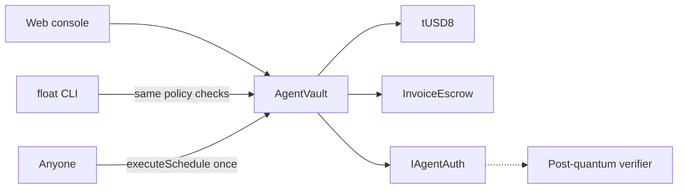

# Float

Give your agents a float, not your keys.

Float is a tUSD8 vault for the Aevum Builder Challenge. The owner deposits the stablecoin and writes a policy. An agent can pay only inside that policy: a per-transaction cap, a rolling day, an allowlist, an expiry, and pause or revoke. A sentence — from a person or from a parser — is only an intent. The vault is the authority.

Network: **Aevum testnet, chain id 44005**. Not QDay Origin (44003). Native gas is tQDAY, 18 decimals. RPC, explorer, faucet, and the tUSD8 address live in one file: `packages/sdk/src/config.ts`. The token decimals there are marked **UNVERIFIED**. Do not copy the token address into another file.

Vault, escrow, router, and auth addresses in that file are empty until you deploy. Live mode refuses to invent a transaction while they are empty.

## Architecture



- **AgentVault** holds the token. Agents call `pay`, or a relayer submits an EIP-712 intent (domain name `Float Vault`). A late schedule pays once and sets `nextRun = now + interval`.
- **InvoiceEscrow** holds a payment until delivery is confirmed, the confirm window elapses, the due date passes, or the arbiter resolves a dispute.
- **IAgentAuth.verify(claimedSigner, digest, signature)** is the only signature check. ECDSA ships today. A post-quantum verifier replaces it with `setAuth`.
- The **console** defaults to a labelled simulation that copies those rules. **Live (Aevum)** uses wagmi and viem: `simulateContract`, then `writeContract`. Reverts (including `PayeeNotAllowed`) are shown as the contract returned them, with the transaction hash and an explorer link when a send succeeds.

## Layout

```
contracts/       Foundry
packages/sdk/    chain config and the typed vault client
cli/             float binary, keystore, MCP
agent/           payables script, x402 demo, AGENTS.md
src/             web console
```

## Contracts

From `contracts/` (OpenZeppelin and forge-std are installed locally, not committed):

```
forge install foundry-rs/forge-std OpenZeppelin/openzeppelin-contracts --no-commit
forge build
forge test
```

`forge test` includes a case where a schedule is 10 hours late: one execution charges once, an immediate second call reverts `NotDue`, and the next interval is the second charge (`runs == 2`).

Local deploy (Anvil account #0 is the default key, local only):

```
anvil
cd contracts
forge script script/Deploy.s.sol --rpc-url http://127.0.0.1:8545 --broadcast
```

That writes `contracts/deployments/latest.json`. If `TUSD8_ADDRESS` is unset, the script deploys `MockTUSD8` (8 decimals, so `150e8` in the tests is 150 whole tokens). Do not deploy the mock on Aevum. After a real deploy, paste the addresses into `packages/sdk/src/config.ts` only.

## CLI

Node 22. The binary is `float`. The keystore is scrypt + AES-256-GCM. The private key is never printed. The password is `FLOAT_PASSWORD` or a TTY prompt, never an argv value.

```
export FLOAT_PASSWORD='choose-one'
float init --json
float link --json
float admin deposit 1000 --json
float admin approve --per-tx 150 --daily 400 --allow "Acme Studio,DataRelay" --json
float invoice pay agent/invoices/INV-0142.json --json
float pay "Acme Studio" 180 --memo over --json
float chat "pay Northwind 10 tUSD8" --yes --json
float x402 --json
float mcp
```

`chat` only parses the sentence into a typed intent (`source: "parser"`). `--yes` submits that intent through the same ledger functions as `pay` and `invoice pay`. There is no model call, and a parsed intent still loses to the policy. Northwind is rejected with `PayeeNotAllowed` because it is not on the allowlist.

`float mcp` speaks MCP over stdio: `float_balance`, `float_policy`, `float_pay`.

## x402-style demo

Not full x402 compliance.

What matches the idea: the resource answers **402** with a price, chain, and `payTo`. The agent pays from the vault, retries with `X-Payment-Proof`, and a second use of that proof is rejected.

What differs: the proof is a raw id, there is no facilitator `/verify` + `/settle`, and the sandbox amounts are whole tUSD8 rather than base units (`amount * 10^decimals` on chain). Network is `eip155:44005`. The token field is read from the SDK config.

```
node --experimental-strip-types agent/x402-demo/server.ts
node --experimental-strip-types agent/x402-demo/client.ts
```

## Web console

Simulation is the default, so the demo runs without a wallet. Switch to **Live (Aevum)** to connect an injected wallet, switch to chain 44005, and send real transactions once the vault address is set.

The operator path includes **Try Northwind**: a payment to a payee that was never allowlisted. Simulation records `PayeeNotAllowed`. Live mode asks the contract and shows that revert from `simulateContract`.

The bar at the bottom only parses text. It shows the typed intent. Execute goes through the same checks as the buttons.

## Post-quantum

`IAgentAuth` takes the claimed signer on purpose. Dilithium and Falcon do not recover an address. The digest is still EIP-712 over keccak. Replacing the hash is a separate change. See [SECURITY.md](SECURITY.md) and [DEMO.md](DEMO.md).
